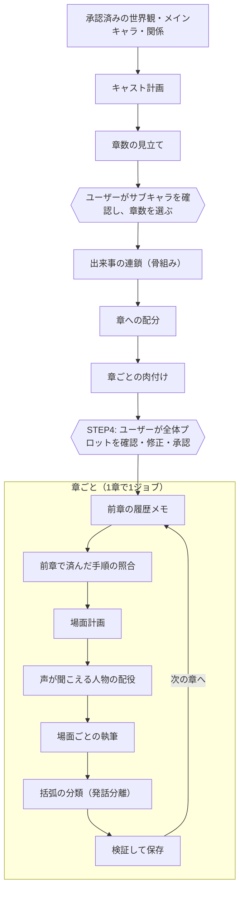

# 台本生成のしくみ

この文書は、承認済みの世界観とキャラクターから、ビジュアルノベルの台本（人物ID付きの台詞とト書き）を何章にもわたって書かせる仕組みを解説します。LLMのAPIを使ったことがあり、コンテキスト長や構造化出力（JSONスキーマで回答の形を縛る機能）を知っている人を想定しています。

扱う範囲は、プロットの作り方と、章を重ねても話が壊れないようにする工夫です。表情・立ち位置などの演出、背景やイベントCG、BGM、音声は、台本の文面を変えないので扱いません。

記述は2026-10-28時点のコードに基づきます。古い設計資料には今と違う内容も多いので、現在の動きについてはここに挙げたソースコードを正としてください。経緯の説明には設計資料と実験記録を参照しています。

## 1. 前提

- **モデル**: 基準はローカルの Gemma 4 31B（`gemma-4-31B-it-UD-Q4_K_XL`、llama.cpp のサーバーで実行）です。台本の工程はすべてこの1つのモデルで行い、工程ごとにモデルを切り替えません。OpenRouter などの外部APIのモデルも選べます（24GB VRAM に収まらない環境のための代替）。
- **推論（思考）**: 台本の工程は既定で推論なしです。32k以上のコンテキストでは設定で有効にできます。設計の良し悪しは、まず推論なしの Gemma で判断しています。
- **コンテキスト長**: 16,384 / 32,768 / 65,536 トークンの3段から選びます。段によって作れる作品の大きさが変わります（5.9節）。
- **作品の規模**: 1章はオート再生で約10分、本文約4,000字・うち台詞約2,000字を目安にします。章数は1〜8章です。

### 台本の形式

LLMが書く台本は、1行1発話のプレーンテキストです。

```
hina: 休憩にしない？　温かいの、二つ用意したんだけど。
NARRATOR: 凛花は二つのカップを台の端に置き、ひなの横から箱を支えた。
rinka: ここなら離さなくていいでしょ。
```

行頭は登場人物のIDか、地の文を表す予約語 `NARRATOR` です。人物IDの行は実際に声に出す言葉だけで、動作は `NARRATOR` の行に書きます。この形を崩さないことが、後段（音声合成・演出・ティラノスクリプトへの変換）の前提になっています。

## 2. 全体の流れ



計画は2回のジョブに分かれます。1回目でキャスト計画と章数の見立てを作って止まり、ユーザーがサブキャラを確認・修正して章数を選ぶと、2回目で出来事の連鎖から肉付けまでを作ります。全体プロットをユーザーが承認すると、本編の制作が始まります。本編は1章ごとに別のジョブです。章の間は「チェックポイント」と呼ぶ保存データで受け渡します。中身は全体プロット、キャスト、これまでの全章の台本の本文、履歴メモ、使った場所の一覧などで、受け取る側はハッシュで改ざん・取り違えがないことを確かめます。

### LLMへの依頼の一覧

| 工程 | 回答の形 | 回数 | 主なコード |
|---|---|---|---|
| キャスト計画 | JSON | 作品で1回 | `script_continuation.py` の `cast_plan` |
| 章数の見立て | JSON | 作品で1回（サブキャラを直すたびに再実行） | `planning_run.py`、`script_chapter_count.py` |
| 出来事の連鎖 | JSON | 作品で1回 | `long_outline`、`script_plot.py` |
| 章への配分 | JSON | 作品で1回 | `long_outline`、`script_plot.py` |
| 肉付け | JSON | 章の数だけ | `expand_plot`、`script_expansion.py` |
| 全体プロットの修正 | JSON | ユーザーが指示したとき | `planning_run.py` の `revise` |
| 履歴メモ | 自由文 | 第2章以降、章ごとに1回 | `write_chapters` |
| 済んだ手順の照合 | JSON | 第2章以降、章ごとに1回 | `script_route_progress.py` |
| 場面計画 | JSON | 章ごとに1回 | `chapter_plan`、`script_chapter_plan.py` |
| 声の配役 | JSON | 章ごとに1回（未定義の声があれば1人1回追加） | `script_voices.py` |
| 場面の執筆 | 台本テキスト | 場面ごとに1回（出力上限で切れたら続きを1回） | `write_scene` |
| 括弧の分類 | JSON | 括弧がある場面だけ | `narrative.separate_speech` |

コードはすべて `services/worker/generation/` にあります。中心は `script_continuation.py` の `ScriptRun` クラスです。

## 3. 基本の考え方

細かい工夫の前に、全体を通している方針を4つ挙げます。ほとんどの工夫はここから出てきます。

### 3.1 未来はプロットから、過去は実際の台本から

全体プロットは「これから起きる予定」、書き上がった台本は「実際に起きたこと」です。この2つを混ぜません。

- 次の章を計画するときの「今どこにいるか」は、保存済みの台本の本文から読ませます。プロット上の予定の開始状態は、あくまで予定として渡します。
- 台本が予定どおりに進まなかったら、台本のほうを事実として受け入れ、未執筆の部分で予定の目的へつなぎます。予定に合わせて過去を書き換えたり、起きていないことを起きたことにしたりはしません。
- 物語の核心（中心の課題、外的な決着、人物・関係の着地）は計画時に固定し、執筆中に変えません。変えてよいのは手段と順序だけです。

この区別は指示文の随所で繰り返しています（`script_continuation.py` の `PROGRESSION`、`ADAPTATION`、`script_plot.py` の `PLOT_PRIORITY`、`script_context.py` の `SOURCE_RULES`）。

### 3.2 同じ出来事の「正本」は1つだけ

主要な出来事は、出来事の連鎖にある「手順」（誰が・何をして・どうなったか）だけを正本とします。章の要約や旧形式のあらすじ（`route`、`outline`）は、手順からコードで組み立てる表示用のもので、LLMに別に書かせません。

同じ出来事を、プロット・章の要約・あらすじと何度も別々に書かせると、少しずつ食い違った版ができ、どれに従うべきかモデルが迷います。初期の版では、人物の行動計画と出来事の経路を別々に作らせて、両者が競合したことがありました。

### 3.3 意味の検査で止めず、壊れた出力だけをコードで止める

生成した内容を別のLLM呼び出しで「矛盾がないか」「計画どおりか」と採点し、不合格なら作り直す、という仕組みは置いていません。コードが厳密に確かめるのは、機械的に判定できることだけです。

- 人物ID・場所IDが登録済みのものか
- 件数・順序・章番号が合っているか
- 台本の各行が `ID: 本文` の形になっているか
- 保存済みのデータが改ざんされていないか（ハッシュ）

これらに違反した回答は、違反内容を添えて1回だけ形式の直しを依頼し、それでもだめなら止めます。内容の出来の評価は、生成後に人が通読して行います。

採点と作り直しを置かない理由は6節で説明します。照合の依頼（5.4節）や声の洗い出し（5.7節）はLLMを使いますが、合否を判定して作り直させるものではなく、次の工程に渡す情報を集める役目です。

### 3.4 間違えにくい形を回答の形式で作る

指示文で「〜しないでください」と頼むより、構造化出力のスキーマでそもそも書けなくするほうが確実です。

- 人物IDの欄は、登録済みのIDだけを `enum` にします。全体プロットの核心にある人物欄は、メインキャラの人数ちょうど（`minItems`/`maxItems`）で、各IDを1回ずつ書かせます。
- 章への配分の境界番号は、出来事の数を `maximum` にします。
- 肉付けで足せる手順の数や挿入位置の上限も、スキーマの数値で縛ります。
- 先に考えさせたい欄をJSONの前のほうに置きます。たとえばキャスト計画では「メインの周りにいる人」の欄を最初に、肉付けでは「どの手順の後に置くか」を手順の中身より先に書かせます。

外部APIでは、件数や数値の範囲（`maxItems`、`maximum` など）をスキーマに入れたまま送れないことがあるため、スキーマからは外し、同じ制約を依頼の末尾に文章で書き添えています（`llm_providers.py` の `schema_limits`、`_with_limits`）。

## 4. プロットの作り方

プロットは「骨組みを作ってから、章ごとに肉付けする」2段階です。章数に応じて骨組みの出来事を増やすだけだと、長い作品ほど1章あたりの中身が薄まったためです（5章にした実験で、各章の手順が2つずつしかなくなった。`docs/experiments/long-form-expand-20261020.md`）。

### 4.1 キャスト計画

承認済みのメインキャラ（最大3人）の周りに、サブキャラを設計します。

- 指示文に章数を書きません。キャストを見てから章数を決めるためです。
- 人数の目安も書きません。数を示すとその数に寄るので、代わりに「メインの身近にいる人・出会う人・対立する人を、この世界から考える」ように頼みます。回答の最初の欄 `surroundings` にそうした人を挙げさせ、その中から台詞と出番がある人をサブキャラにします。
- 上限はユーザーが承認時に決めたキャラ数（メイン込み）で、スキーマの `maxItems` で縛ります。少人数の密な話なら少なく、学校や軍のように人が集まる話なら多くなります。
- サブキャラごとに、本人の普段の用事・関心、メインとの接点、初めに知っていること・知らないことを書かせます（`everyday_context`）。「解説係」や「問題を代わりに解く人」だけにならないようにするためです。
- 人物同士の関係（`connections`）は、IDの組で書かせます。参照するIDが壊れていたら、関係の文面は変えずに参照の割り当てだけを直す小さな依頼を出します（メイン同士の既知の組はコードが直します）。

### 4.2 章数の見立て

キャストが決まったら、この作品に何章（1章約10分）が適しているかをLLMに見立てさせます（`script_chapter_count.py`）。人数や出来事の数から決めさせると、作品の性質と関係なく数が増減するので、次の3点を順に書かせてから章数を出させます。

1. **持続力**: 設定や面白さが、どれだけの長さに耐えるか。1つのネタで成り立つ話は長くするとダレる。
2. **構造**: 主人公が中心に動く話か、各人物が自分の用事で場面を背負う話か。主人公中心の話を長くすると冗長になる。
3. **個性**: 自分の見せ場を持てるほど個性が立った人物は誰か。

この作品と関係のない架空の作品4つで、この3点から章数を決めた例を添えます。上限は8章で、「8章は容量であり目標ではない」と明記しています。ユーザーはこの見立てを目安に、コンテキストの段が許す範囲で章数を選びます。

### 4.3 出来事の連鎖（骨組み）

選んだ章数で、作品全体の出来事を1回の依頼で作ります（`script_plot.py` の `StoryChainDraft`）。回答は次の順に書かせます。

1. **核心（`core`）**: 中心の課題、外的な決着、人物・関係の着地。決着は「誰が何をした結果、障害や相手側のどの条件が変わるか」まで、着地は感謝や理解の宣言ではなく本人たちの行動で書かせます。メインキャラ全員について、最初の振る舞い、守る価値観、最後に取る具体的な行動も書かせます。
2. **決着の下書き（`resolution_basis`）**: 最大2件。「先に誰の行動で何を得るか」と「後でその結果の何を使って何を変えるか」の組です。終盤の決着が、何の準備もなく都合よく起きるのを防ぐためのメモです。この欄は回答の中で考えさせるためだけにあり、保存するプロットには残しません。
3. **冒頭の状態（`opening_condition`）**: 承認済みの設定から見た、作品が始まる時点の状態。
4. **出来事（`events`）**: 章数〜章数×3個。各出来事は1〜6個の手順からなり、手順は「人物ID・行動・結果」です。次の手順は前の結果を受けた選択として書かせます。

2つ目以降の出来事の開始状態は、LLMに書かせず、コードが前の出来事の最後の結果から作ります（`as_chain`）。以前は各出来事の開始状態も自由に書かせていましたが、開始状態の文は出来事の手順と独立しているため、「連れ去られた後」のような未発生の大事件が紛れ込む場所になりました。実際に、現実へ戻った人物を、後の章の計画が連れ去られた後の状態として扱い、その経緯がどの場面にも描かれない例がありました。移動・発見・関係の変化が後で必要なら、それを起こす手順を出来事の中に置かせます。

この時点では章の境目を決めません。出来事の個数も、場面数や章の数とは別物だと伝えています。

### 4.4 章への配分

連鎖を章に切り分けます。境目の候補はコードが作ります。

- 出来事の切れ目で切る方法をすべて数え上げ、各章の手順数のばらつきが小さい順に30通りまでを、章ごとの手順数と一緒に渡します（`balanced_boundary_options`）。
- LLMは、候補の中から「結果や選択が一区切りになる」ものを選び、各章の題名、役割（その章で新しく経験することと、変わる到達状態）、会話の材料を書きます。候補にない区切りは受け付けません。
- 出来事の数が章数と同じなら、区切り方は1通りなのでコードが確定し、LLMには題名・役割・会話の材料だけを頼みます。

LLMに自由に区切らせると、第1章が導入の出来事1つで終わる偏りが出ました（保存済みの配分12件のうち9件で、第1章は2手順だけ。`docs/experiments/cast-size-20261017.md`）。切り分け自体はコードが行うので、出来事が書き換わったり、重複・抜けが出たりすることはありません（`allocate_chapters`）。

**会話の材料（`conversation_topics`）** は、主筋とは別に、その章で人物同士が交わすやり取りの種です。「設定を説明して相手が動揺する」「信頼が深まる」のような抽象的な目標ではなく、「本人がその場で済ませたい用事」と「相手が自分の都合から返し、それを受けて何をするか」を1〜2文で書かせます。主筋の選択や結末はここに置かせません（正本は手順だけ、の原則）。

### 4.5 章ごとの肉付け

配分した骨組みに、1章ずつ手順を足します（`script_expansion.py`）。

- 渡すもの: 全章の骨組み（題名・役割・手順）、肉付け済みの前の章、当章の骨組みの手順（番号付き）。
- 回答: 足す手順だけです。それぞれ「骨組みの何番の手順の後に置くか（`after_step`）」を付けます。骨組みの手順は回答に含めさせず、コードがそのまま残すので、骨組みが書き換わることはありません。
- 量: 骨組みと合わせて1章4〜6手順を目安にし、上限6手順をスキーマで縛ります。これより多いと、1章が10分を大きく超えました。
- 足す手順の中身: サブや脇の人物自身の用事・対立による行動や、メインとサブの具体的なやり取りが中心です。骨組みの手順の言い換えや前振り、前の章で済んだことの繰り返し、他の章の骨組みの先取りは禁じます。同じ人物に前の章と同じ役回り（同じ種類の転機など）をさせることも禁じます。
- 最終章: 骨組みの最後の手順は作品の締めなので、その後ろには手順を置けないようにスキーマの `after_step` の最大値を下げます。

肉付けした章の開始状態は、前の章の肉付け後の最後の手順の結果にします。以前は骨組みの開始状態をそのまま使っていたため、前の章で骨組みより後ろに足した手順が、次の章の開始状態の前に来る食い違いがあり、場面計画が前の章の手順を演じ直しました（`docs/experiments/chapter-starts-20261024.md`）。

### 4.6 別の姿（衣装違い・変身）

メインキャラに承認済みの別の姿がある場合だけ、出来事の中にその姿になるきっかけを含めさせ、各章にどの姿が出るか（`outfit_appearances`）を書かせます。承認した姿が少なくとも1回はどこかの章に出ることをコードで確かめます。姿を見せるためだけの出来事は足させません。

### 4.7 ユーザーの確認と承認

できた全体プロットは STEP4 でユーザーが確認し、直接編集するか、自由文の指示でAIに直させます（全体・特定の章・特定のサブキャラ・関係だけ、のいずれか）。AIの修正でも、メインキャラ・承認済みの関係・章の数と順序は維持させます。承認すると計画の内容とハッシュが固定され、本編の各章はこの承認済みの計画と照合されます。

## 5. 長い作品で話を壊さない工夫

ここからが本題です。章を重ねたときに起きた問題は、おおむね次の4種類でした。

- **繰り返し**: 毎章同じ導入から始める、前の章の最後の台詞を写して始める、済んだ出来事を演じ直す。
- **先取り**: ある章が次の章の予定まで描いてしまい、次の章が言い直しになる。
- **忘却・巻き戻り**: 前の章の約束や変化（回復、仲直りなど）が次の章に引き継がれない。
- **参照の破損**: 存在しない人物IDに台詞を与える、場所の名前が章ごとに変わる。

以下、何をどう渡しているかを工程ごとに説明します。

### 5.1 過去は要約ではなく、台本の原文で渡す

次の章の計画と執筆には、これまでの全章の台本を原文のまま渡します。要約や「人物の状態」の表だけで引き継ぐと、要約から落ちた約束や回復が次の章で消えたためです。初期の版では前章の最後の8行と状態の要約だけを渡していて、毎章同じ導入を繰り返しました。

コンテキストに収まらないときは、`script_context.py` の `fit_context` が次の順に入力を減らします。毎回、依頼全体（指示・資料・JSONスキーマ・回答枠）のトークン数を測り、収まった時点で止めます。ローカルのモデルでは、llama.cpp のサーバーにチャットテンプレートを適用させてからトークン化させ、実際に送る形で数えます（外部APIでは見積もり）。

1. 文体の作例を外す（作例は形式の参考で、物語の資料ではないため最初に削る）。
2. 遠い章から順に、後の章の予定を「題名・役割・到達点」だけにする。
3. 古い完了章から順に、原文を履歴メモ（5.2節）に置き換える。メモが取得できていない章は置き換えない。
4. 直前の完了章は、冒頭側を履歴メモで補い、後ろ側の原文を残す。少なくとも1,200字、かつ最後の場面は必ず原文で残す。切る位置は場面の境目を優先し、なければ行の境目にします。収まる範囲でなるべく多く残せる位置を二分探索で探します。

それでも収まらなければ、容量不足のエラーで止めます。設定・作業依頼・今書いている章の既出部分・回答枠は決して削らず、文章を途中の文字位置で切ったりもしません。勝手に削って続けると、気づかないうちに資料が欠けた状態で書き進めることになるからです。どこを削ったかは依頼ごとに記録しています。

### 5.2 履歴メモ

第2章以降の最初に、前の章の台本だけを読ませて、1,000字以内を目安に履歴メモを作らせます（`script_continuation.py` の `HANDOFF`）。モデルには「記録係」の役を与え、創作・評価・次章の提案を禁じます。見出しは次のとおりです。

- 実際の行動と結果（誰が何を試し、何が分かったか、相手の反応）
- 人物の選択（何を拒み、何を受け入れたか。前から認めていたことと新しい判断を分ける）
- 人物の評価・推測（誰がそう言ったかを人物ID付きで。発言を客観的な事実に変換しない）
- 変わっていないこと・未決事項（まだ同意していないこと、残っている約束）
- 到達点（今いる場所・状況、済んだ作業や決断）

重要な判断には、短い原文の引用を添えさせます。台本にない動機や内心を補わせず、「従った」ことから「納得した」と推測させないように、とも指示しています。

このメモは、原文がコンテキストに入らないときの代わりとしてだけ使います。原文が入るときはメモを重ねません。同じ出来事の2つの版を並べると、古いメモの解釈が新しい台本の結果を巻き戻すことがあるためです。

### 5.3 資料の読み方の共通ルール

すべての依頼のシステム指示の末尾に、資料の扱い方を付けています（`SOURCE_RULES`）。要点は次のとおりです。

- 保存済みの台本は、すでに起きた出来事の一次資料。写して使う文例ではない。
- 台詞の中の評価・非難・推測は、その人物の見方。そう発言した事実と、内容が正しいかどうかを分ける。
- 全体構成と作業依頼は予定。台本に書かれていない予定を実績にしない。
- 履歴メモは補助資料。メモの解釈や提案を作業指示にしない。
- 省略された台本の内容を、起きなかったことと解釈しない。

資料の並べ方にも意味があります。設定 → 未来のプロット → 過去の台本 → 「保存済み台本の最後の反応が現在の到達点です」という一文 → 作業依頼、の順にし、依頼が古い台詞で終わらないようにしています。最後に読んだ台詞を続きとして書き写すのを防ぐためです。

### 5.4 章の範囲を守る

ある4章の作品で、第3章の場面計画が第4章の予定の手順6つのうち5つを取り込み、「物語が締めくくられる」で終わりました。第4章には1手順しか残らず、場面計画は第3章で済んだやり取りを言い直しました（`docs/experiments/scope-guard-20261022.md`）。対策は2つです。

**後の章は概要だけ渡す。** 場面計画には、当章の手順は全部、後の章は題名・役割・到達点だけを渡します（`script_route_progress.later_in_brief`）。次の章の手順が細かく見えていると、モデルはそれを当章で実行してしまいます。

**前の章で済んだ手順を照合する。** 第2章以降の場面計画の前に、短い依頼を1回出します。前の章の台本と当章の予定の手順を並べ、「台本の中で実際に起きた手順」だけを選ばせます（`script_route_progress.py`）。

- 選択肢は手順の番号の `enum` で、選んだ手順ごとに、起きたと分かる台詞や描写を引用させます。
- 準備しただけ、話題に出ただけ、途中までの手順は選ばせません。迷ったら選ばせません。
- 選ばれた手順は当章の予定から外し、「保存済み台本ですでに起きた手順」として別に渡します。場面計画には「再演・言い直しをせず、その結果から続ける」と伝えます。

これは採点ではなく、当章の計画の材料を整える作業です。判定が外れても、作り直しのループには入りません。

### 5.5 章の書き出しを前の章と重ねない

第2章の冒頭が、第1章の最後の場面の台詞をほぼそのまま写して始まる例がありました（約15行）。原因は、場面計画に書かせる「当章の最初の新しい行動」の欄に、前の章の最後の出来事がそのまま入り、本文がそれを新しい行動として演じ直したことです（`docs/experiments/chapter-opening-20261024.md`）。

そこで第2章以降の場面計画では、2つの欄を分けて先に書かせます（`SplitChapterPlan`）。

- `reached`: 保存済みの台本の最後で、上演済みの到達点。「誰がどこで何をし終え、どういう状態か」を1文で。
- `continuation`: その後で、誰が最初に何を新しく行うか。`reached` の動作や前の章で済んだ発言は含めない。

この2文はコードが第1場面の最初の出来事に埋め込み、本文には「直前の到達点（前章で上演済み）」と「最初の新行動」として渡します。同じ内容を章全体の指示としても重ねて渡すと、2つ目以降の場面がまた章の書き出しからやり直しかねないので、渡す場所はこの1か所だけです。

念のため、コードでも転載を取り除きます。第2章以降の最初の場面が、前の章の最後と完全に同じ行（6発話以上・本文300字以上）で始まっていたら、その部分を削ります（`script_overlap.py`）。完全一致だけを対象にし、言い回しの違う繰り返しには手を出しません。削った範囲と元の出力は記録に残します。

### 5.6 場面の範囲を守る

章の中も、場面ごとに分けて書かせます。1章は最大8場面で、場面計画（`ScenePlan`）には場所、登場人物、目的、開始状態、描く出来事（最大8件）、終了状態を書かせます。場面計画が執筆の唯一の直接の指示です。

場面を書く依頼には、次のものを渡します（`script_inputs.scene_material`）。

- その場面の計画
- 同じ章ですでに書いた場面の原文（削らない）
- 前の章までの台本（5.1節の範囲で）
- 後続の場面が担当すること（「未実施」と明記）

そのうえで「終了状態に着いたら止める」「後続の場面に残す行動・決断・退場・結末を先に描き切らない」「すでに済んだ予定は再演しない」と指示します（`SCENE_SCOPE`）。初期の版では、後の場面の決着を前の場面が先に描いてしまう先取りが残っていたためです。

一方、その場面に関係しない資料は削ります。登場しない人物は名前と役割だけ、場所はその場面の1か所だけ、関係はその場面の人物が絡むものだけにします。当章の出来事の一覧も、場面計画と重複するので外します。資料が減るほど、関係のない人物や場所を持ち出す余地も減ります。

**分量**: 場面計画では、場面ごとに相対的な分量（`length_weight`、1〜10）を付けさせます。コードが章全体の目安（本文約4,000字・台詞約2,000字）をこの重みで割り振り、各場面の目的の末尾に「本文約○字、うち台詞約○字」と書き添えます。字数で合否は判定しません。大きな発見や判断の途中に分量を多く配り、既知の設定の再説明に使わないよう指示しています。

**出力枠**: 場面ごとの回答トークン数（`max_tokens`）は、割り振った字数と話者IDの長さから見積もります（`script_budget.py`）。同じモデルで書いた過去の場面の実績（1字あたりのトークン数）があれば、それも使います。全場面に一律の大きな枠を予約すると、その分だけ入力に使える量が減り、過去の台本が入らなくなったためです。

**出力が切れたら**: 回答が上限で切れたときは、同じ場面の続きを1回だけ依頼します。その際、切れた原稿の末尾160字を「接続用の文字列」として渡し、回答の先頭で一字も変えずに繰り返させます。コードは回答の先頭がその文字列と一致するかを確かめてからつなぎます。一致しない、または2回目も切れたら止めます。どこでつながったかを推測で補わないためです。

### 5.7 人物と場所の参照を壊さない

**台本の形式を文法で縛る。** ローカルのモデル（推論なし）では、llama.cpp の文法制約（GBNF）で、各行の先頭をその場面の登場人物IDか `NARRATOR: ` に限定します（`narrative._source_grammar`）。行頭以外の本文は自由に書けます。外部APIには文法制約がないので、使える人物IDの一覧を依頼の末尾に文章で書き、生成後に同じ規則で検証します。推論ありのときも、思考の部分まで縛れないので、生成後の検証だけになります。

**声だけの人物を配役する。** 無線の祖父の声が主人公の台詞になった作品がありました。場面計画が祖父を「出来事」として扱い、人物として配役しなかったため、執筆側は配役にいる人物のIDを借りるしかなかったのです。場面計画に新しい人物を足させようと、回答の項目順や指示文を変えたり推論を有効にしたりしても、試した12件で1人も足しませんでした。保存済みの場面計画を見ても、推論なしで新しい人物を足したものは240件中0件です（`docs/experiments/heard-voices-cast-20261016.md`）。

そこで場面計画の後に、軽い依頼を1回出します（`script_voices.py`）。各場面で台詞が聞こえる人物を、電話・無線・録音・回想の声も含めて挙げさせ、まだ人物として定義されていない声は別の依頼で人物として作り、声が聞こえる場面に配役します。計画が人物を足さないなら、足すことだけを別の小さな仕事にしたわけです。

**場所の名前を固定する。** 場面計画には、これまでに使った場所のIDと名前の一覧を渡し、既存のIDを使うなら名前を変えないことをコードで確かめます。使わない場所の定義は捨てます（LLMの回答そのものは記録に残します）。

**新しい人物は使う人だけ。** 場面計画が足した新しい人物は、その章のどこかの場面に出ることを確かめ、出ない人物の登録を受け付けません。

**台詞に混ざった動作を地の文へ移す。** 書き手のモデルは、形式を指示しても `rinka: （笑って）そうだね` のように台詞の行へ括弧書きの動作を混ぜることがあります。そのまま読み上げると動作まで声になるので、括弧の部分を「実際に声に出す言葉」「目に見える動作」「声の演技指示（小声で、など）」に分類させ、動作は人物名を補った自然な地の文の行に、演技指示は読み上げない付随情報にします（`narrative.separate_speech`）。括弧の外の台詞には手を触れません。次の場面や次の章に渡る台本は、この整えた後の本文です。

### 5.8 予定外の出来事を受け入れる

LLMは計画どおりには書きません。台本に予定外の言動が出たとき、それを無視して予定どおりに進めると、話が噛み合わなくなります。逆に、予定の結末に合わせて過去の意味を読み替えるのも破綻のもとです。指示文では次のように扱わせています（`ADAPTATION`、`PLOT_PRIORITY`）。

- 実際に起きたことを事実として引き継ぐ。ただし、事実として引き継ぐことと、その行動を肯定することは別。
- 予定外の言動があれば、相手の反応や関係への影響を受けて、未執筆の部分を調整する。
- 予定した結末に合わせて、圧力を「尊重」、従ったことを「合意」と読み替えない。
- 決着済みのことを、事情の変化なしに再び争点にしない。
- 外的な作業が終わっただけで、人物や関係の課題も解決したことにしない。
- 予定の開始状態が台本と違うなら、台本から出発し、必要な経緯を当章の場面で描く。未発生の大事件を場面の開始状態に埋めて済ませない。

全体プロットそのものを途中で作り直す仕組みは持っていません。核心を固定したまま、各章の場面計画が手段と順序を調整します。

### 5.9 コンテキストの段と、作品の大きさの上限

人物の設定、関係、別の姿、全章のプロットの核心は、毎回ほぼ丸ごと入力に入ります。削れるのは過去の章の本文、作例、後の章の詳細だけです。そのため、作れる作品の大きさをコンテキストの段ごとに決めています（`script_cast.py` の `TIER_LIMITS`）。

| 段 | 章数の上限 | キャラ数の上限（メイン込み） | 別の姿（メイン全員の合計） |
|---|---|---|---|
| 16k | 3 | 4 | 3 |
| 32k | 8 | 8 | 制限なし |
| 64k | 8 | 11 | 制限なし |

16kの値は、3章・メイン3人・サブ1人・別の姿3つで、最終章の場面計画の入力に約600トークンしか余らなかった実測から決めています。推論は回答の枠を使い、入力の量は変えないので、上限は推論の有無で変わりません。

### 5.10 長いジョブを途中から再開できる

1作品の生成には多数の依頼があり、途中で止まることがあります。そのため、すべての依頼と回答を作業フォルダの記録（`draft-state.json`）に残します。

- 依頼ごとに、送る資料全体のハッシュを記録します。再開時に同じ資料の依頼があれば、保存済みの回答を使い、同じ結果を再現します。
- 1つの依頼の送信は2回までです。通信などの失敗の再送も、構造の不備の直し（3.3節）も、この2回の中で行います。使い切ったら止め、ユーザーが明示的に再試行したときだけ新しい枠を与えます。
- 場面単位で確定したものを保存するので、章の途中で止まっても、書き終えた場面からやり直す必要はありません。

## 6. 採らなかった方法と経緯

今の形は、うまくいかなかった方法を外していった結果です。主な流れを挙げます。

| 時期 | 方式 | 起きたこと |
|---|---|---|
| 初期 | 章ごとに独立して場面を計画し、前章の最後の8行と人物の状態の要約を引き継ぐ | 毎章同じ導入、前章末の7発話の転載、第2章で回復した体が第3章で説明なく悪化 |
| 2026-09-25頃 | 本文から事実と状態の変化を抽出して台帳にし、場面ごとに台帳と照合・検査し、不合格なら修復する（`causal_narrative.py`、`chapter_editor_v1`） | 検査と修正で止まり、第1章の場面計画から先に進まない。状態の比較で推論が出力枠を使い切った |
| 2026-09-26 | プロットの手順に番号を振り、章計画で各手順を場面へ割り当てて全件照合する | 番号の割り当ての不備で、第1章の本文に着く前に止まる |
| 2026-09-26〜 | 今の方式の土台（`script_continuation_v1`）：直接の場面計画、実際の台本の原文での引き継ぎ、意味の検査なし | 16k・3章で最後まで完走。以後、この上に改善を重ねた |
| 2026-10-19〜24 | 長尺化：章数の見立て、骨組みと肉付け、章の範囲の照合、書き出しの分割 | 4〜6章でも完走。先取りと書き出しの転載を個別に対策 |

検査を厚くする方向をやめた理由は、主に次の3つです（`docs/research/story-consistency-and-overthinking-20260925.md`）。

- 検査役のLLMも、重要な問題を見落としたり、許容できる描写を止めたりする。実際、検査と修正に工程が割かれ、本文に着く前に止まった。
- 細かな状態の表を完全に一致させようとすると、推論が長くなり、最終回答に着かない。
- 「おかしければ作り直す」ループは、同じ資料から同じ種類の失敗を繰り返しやすい。直すなら、入力や構造の側を変えるほうが効く。

代わりに、壊れたら困る機械的な部分（ID、形式、件数、保存データ）はコードで厳密に守り、物語の質は「何を、どの順で、どこまで渡すか」で上げる、という方針にしています。5節の工夫の多くは、問題が見つかるたびに入力の渡し方を変えたものです。

## 7. 残っている課題

- 主題を何度も語り直す、地の文で主題を解説する、同じ語彙を繰り返す。
- 途中で出てきた話の糸が、回収されずに消える。
- 本文を書く段階で初めて出てくる一言の声（計画に書かれていない声）は、5.7節の配役では拾えない。
- 32kでキャラ8人・別の姿あり・8章を同時に使う組み合わせなど、上限いっぱいの組み合わせは確かめきれていない。

## 8. コードの場所

| 内容 | ファイル |
|---|---|
| 計画ジョブ（キャスト計画・章数の見立て・プロット・修正） | `services/worker/generation/planning_run.py` |
| 本編の章ジョブと章間の受け渡し | `services/worker/generation/script_production.py` |
| 全工程の本体（キャスト、プロット、場面計画、執筆、履歴メモ） | `services/worker/generation/script_continuation.py` |
| 作品の設定と作品の大きさの上限 | `services/worker/generation/script_cast.py` |
| 章数の見立て | `services/worker/generation/script_chapter_count.py` |
| 出来事の連鎖と章への配分 | `services/worker/generation/script_plot.py` |
| 肉付け | `services/worker/generation/script_expansion.py` |
| 場面計画の形と分量の割り振り | `services/worker/generation/script_chapter_plan.py` |
| 場面ごとに渡す資料の絞り込み | `services/worker/generation/script_inputs.py` |
| コンテキストへの収め方 | `services/worker/generation/script_context.py` |
| 済んだ手順の照合と後の章の概要化 | `services/worker/generation/script_route_progress.py` |
| 声が聞こえる人物の配役 | `services/worker/generation/script_voices.py` |
| 章の境目の転載の除去 | `services/worker/generation/script_overlap.py` |
| 場面の出力枠の見積もり | `services/worker/generation/script_budget.py` |
| 文体の作例 | `services/worker/generation/script_examples.py` |
| 工程ごとのモデル設定（推論なし・出力枠） | `services/worker/generation/model_routing.py` |
| 台本の文法制約と括弧の分類 | `services/worker/generation/narrative.py` |
| 外部APIでの制約の書き添え | `services/worker/generation/llm_providers.py` |
| 新しい計画に付ける設定（`script_options`） | `services/coordinator/planning_service.py` |
